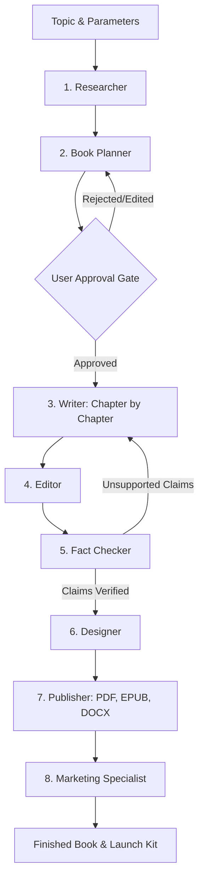

# eBook Studio AI

Turn a topic into a complete, exportable eBook. Give it a topic, audience,
category, language, tone and length, and an **eight-agent AI pipeline** researches,
plans, writes, edits, fact-checks, designs, publishes and markets a finished
book — delivered as **PDF, EPUB and DOCX** with a cover and a full marketing kit.

> **Runnable vertical slice:** register → create a book → generate an outline →
> approve it → run the full-book pipeline → download the exports. The default
> `LLM_PROVIDER=mock` produces deterministic, schema-valid output with no network
> access, so the whole flow works offline.

---

## Table of contents

- [Highlights](#highlights)
- [Architecture](#architecture)
- [The eight agents](#the-eight-agents)
- [Tech stack](#tech-stack)
- [Repository layout](#repository-layout)
- [Prerequisites](#prerequisites)
- [Quick start (Docker Compose)](#quick-start-docker-compose)
- [Local development](#local-development)
- [Demo accounts](#demo-accounts)
- [Configuration](#configuration)
- [Credits model](#credits-model)
- [Exports](#exports)
- [Billing](#billing)
- [Testing & quality gates](#testing--quality-gates)
- [Troubleshooting](#troubleshooting)
- [Current status & roadmap](#current-status--roadmap)
- [License](#license)

---

## Highlights

- **Eight specialised agents** with typed contracts between each stage — no
  single mega-prompt.
- **Provider-agnostic LLM layer.** `mock` by default; point `LLM_BASE_URL` at
  OpenAI, OpenRouter, Groq, Together, vLLM, Ollama or LM Studio.
- **Predictable credits.** Each book is *estimated → checked → charged once*
  (idempotency key `job:<id>:charge`). Failed or cancelled jobs are refunded
  **only** when no work was produced.
- **Resumable jobs.** Steps record their progress, so a crashed or retried job
  picks up where it left off instead of re-billing you.
- **Real deliverables.** A shared `BookDocument` renders to PDF (WeasyPrint, with
  a pure-Python fallback), EPUB and DOCX with front matter, disclaimers and a
  table of contents.
- **No fabricated citations.** The fact-checker flags anything it cannot verify;
  sensitive categories get an automatic disclaimer.
- **Production-shaped backend.** Async SQLAlchemy 2.0, Alembic migrations,
  structured logging, request-id correlation, consistent JSON errors, rate
  limiting, optional Sentry, S3/MinIO or local storage.
- **Typed frontend.** Next.js 15 App Router, React 19, TanStack Query, React Hook
  Form + Zod, Tailwind and hand-built shadcn-style primitives.

---

## Architecture

```
                       ┌──────────────────────────────────────────────┐
                       │                apps/web (Next.js)            │
                       │  Dashboard · Wizard · Outline · Workspace    │
                       │  Cover · Export · Marketing · Billing/Admin  │
                       └───────────────┬──────────────────────────────┘
                                       │ REST + SSE (/api/v1)
                                       ▼
                       ┌───────────────────────────────────────────┐
                       │              apps/api (FastAPI)           │
   Postgres  <────────▶  routers → services -> repositories        |
   Redis     <── queue    │            |              |            │
   MinIO/S3  <───────────  │            v              v           │
                           │      orchestrator     exporters       │
                           │            |                          │
                           │      eight agents ──► LLMClient (mock | openai_compatible)
                       └───────────────────────────────────────────┘
```

- **Routers are thin.** They validate, call a service and serialise a response.
- **Services own the logic** (books, outline, chapters, jobs, credits, exports,
  cover, marketing, billing, storage).
- **Agents never touch the database.** They receive an `AgentContext` and return
  typed output; the service layer persists it.
- **One code path, two runners.** The same pipeline runs inline (default) or via
  an `arq` worker on Redis — progress is streamed to the browser by polling the
  job row over SSE (works for both modes).

---

## The eight agents

| # | Agent | Responsibility |
|---|-------|----------------|
| 1 | **Researcher** | Gathers themes, angles, sources and gaps for the topic. |
| 2 | **Book Planner** | Designs parts, chapters, key points and word budgets. |
| 3 | **Writer** | Drafts each chapter in the chosen voice and length.
| 4 | **Editor** | Tightens prose, removes filler, enforces consistency.
| 5 | **Fact Checker** | Verifies claims and flags anything unverified.
| 6 | **Designer** | Chooses cover art direction, palette and typography.
| 7 | **Publisher** | Renders PDF/EPUB/DOCX with front matter and disclaimers.
| 8 | **Marketer** | Writes the description, keywords, social posts and email sequence.

---

## Tech stack

| Layer | Choices |
| --- | --- |
| API | Python 3.12, FastAPI, Pydantic v2, SQLAlchemy 2.0 (async), Alembic |
| Data | PostgreSQL 16 (prod), SQLite + aiosqlite (dev/tests) |
| Queue / cache | Redis + [arq](https://arq-docs.helpmanual.io/) (or inline execution) |
| Storage | S3-compatible (MinIO / R2 / AWS) or local disk |
| LLM | `mock` or any OpenAI-compatible endpoint |
| Exports | WeasyPrint (optional extra) + native EPUB / DOCX writers |
| Web | Next.js 15, React 19, TypeScript, TanStack Query, RHF + Zod, Tailwind, Radix |
| Tooling | uv, Ruff, mypy, pytest, pnpm, ESLint, GitHub Actions, Docker Compose |

---

## Repository layout

```
.
├── apps
│   ├── api                 # FastAPI service, agents, exports, migrations
│   │   ├── app
│   │   │   ├── agents      # the eight agents + shared contracts
│   │   │   ├── api/routes  # thin HTTP routers
│   │   │   ├── core        # settings, errors, logging, security, rate limit
│   │   │   ├── db          # models, session, base
│   │   │   ├── schemas     # Pydantic request/response DTOs
│   │   │   ├── services    # business logic
│   │   │   └── workers     # arq worker
│   │   ├── alembic         # migrations
│   │   └── Dockerfile
│   └── web                 # Next.js application (App Router)
│       ├── src/app         # routes: landing, auth, dashboard, book wizard…
│       ├── src/components  # UI primitives + app components
│       ├── src/lib         # API client, auth, query keys, utils
│       ├── src/hooks       # use-job-stream (SSE over fetch)
│       └── Dockerfile      # builds from the repo root (shared package)
├── packages
│   └── shared              # shared TS types, Zod schemas, constants
├── infra                   # local infra data dirs (see infra/README.md)
├── docker-compose.yml      # postgres + redis + minio + api + worker + web
└── .env.example            # documented environment template
```

---

## Prerequisites

- **Docker + Docker Compose** for the one-command stack, **or**
  - **Python 3.12** and [uv](https://docs.astral.sh/uv/)
  - **Node.js 22+** and **pnpm 10** (pinned via `packageManager`; Corepack will fetch it)
  - (optional) PostgreSQL 16 and Redis 7 for a fully local non-Docker run

---

## Quick start (Docker Compose)

```bash
cp .env.example .env          # 1. create your env file (defaults work out of the box)
docker compose up --build     # 2. bring up the whole stack
```

Then open:

| Service | URL |
| --- | --- |
| Web app | http://localhost:3000 |
| API docs (Swagger) | http://localhost:8000/docs |
| API health | http://localhost:8000/api/v1/health |
| MinIO console | http://localhost:9001 (`minioadmin` / `minioadmin`) |

The API container runs `alembic upgrade head` on boot. Seed templates and demo
accounts once the stack is healthy:

```bash
docker compose exec api python -m app.scripts.seed
```

> **`.env` is optional** — Compose starts with sensible defaults if it is absent,
> but copying `.env.example` is recommended so you can set `JWT_SECRET` and any
> provider keys.

---

## Local development

### API

```bash
cd apps/api
uv sync --group dev
# Fastest path: SQLite, mock LLM, inline jobs (no Postgres/Redis needed)
export DATABASE_URL="sqlite+aiosqlite:///./ebook_studio.db"   # PowerShell: $env:DATABASE_URL="sqlite+aiosqlite:///./ebook_studio.db"
export JOB_EXECUTION_MODE=inline
export STORAGE_BACKEND=local
uv run python -m app.scripts.seed          # creates the schema on SQLite + demo data
uv run uvicorn app.main:app --reload
```

Using PostgreSQL instead? Run `uv run alembic upgrade head` before the seed
step. The `alembic upgrade` → `downgrade` round-trip is covered by the test suite.

### Web

```bash
cd apps/web
pnpm install
echo "NEXT_PUBLIC_API_BASE_URL=http://localhost:8000" > .env.local
pnpm dev        # http://localhost:3000
```

### One-click launcher (Windows)

Double-click **`start.bat`** in the repository root (or run it from a terminal).
It syncs the API environment, seeds the SQLite database, launches the API and
web app in their own windows, waits until both are up, and opens
<http://localhost:3000> in your browser.

It runs fully offline with SQLite + the mock LLM (no Docker, no API keys).
Close the **eBook Studio API** and **eBook Studio Web** windows to stop it.

---

## Demo accounts

Created by `python -m app.scripts.seed` (never in `production`):

| Role | Email | Password |
| --- | --- | --- |
| Author | `demo@ebookstudio.local` | `demo-pass-123` |
| Admin | `admin@ebookstudio.local` | `admin-pass-123` |

---

## Configuration

All settings live in `.env` (see [`.env.example`](.env.example) for the annotated
list). The most useful knobs:

| Variable | Purpose |
| --- | --- |
| `DATABASE_URL` | Async SQLAlchemy URL (Postgres or SQLite). |
| `REDIS_URL` | Queue, cache and rate-limit backend. |
| `JWT_SECRET` | **Set this in production** — a long random string. |
| `LLM_PROVIDER` | `mock`, `openai_compatible`, `nvidia`, `ollama`, or `local`. |
| `LLM_BASE_URL` / `LLM_API_KEY` | Endpoint + key for your provider. |
| `LLM_MODEL_*` | Per-agent model selection (cheap model for structure, strong for prose). |
| `IMAGE_PROVIDER` | `none` (deterministic covers) or `openai_compatible`. |
| `STORAGE_BACKEND` | `local` or `s3`. |
| `JOB_EXECUTION_MODE` | `inline` (default) or `arq`. |
| `CORS_ORIGINS` | Comma-separated browser origins allowed to call the API. |

### Using NVIDIA NIM Cloud Models

To power the 8-agent pipeline with high-throughput NVIDIA accelerated GPU models:

```env
LLM_PROVIDER=openai_compatible
LLM_BASE_URL=https://integrate.api.nvidia.com/v1
LLM_API_KEY=nvapi-...
LLM_MODEL_DEFAULT=meta/llama-3.1-8b-instruct
LLM_MODEL_WRITER=meta/llama-3.3-70b-instruct
LLM_MODEL_FACT_CHECKER=meta/llama-3.3-70b-instruct
```

### Running 100% Local LLMs (Ollama & LM Studio)

No API key is required when running locally:

**With Ollama:**
1. Install and start Ollama: `ollama run llama3.2`
2. Configure `.env`:
   ```env
   LLM_PROVIDER=ollama
   LLM_BASE_URL=http://localhost:11434/v1
   LLM_MODEL_DEFAULT=llama3.2
   ```

**With LM Studio:**
1. Load a GGUF model in LM Studio and click **Start Server** (port 1234).
2. Configure `.env`:
   ```env
   LLM_PROVIDER=local
   LLM_BASE_URL=http://localhost:1234/v1
   LLM_MODEL_DEFAULT=local-model
   ```

You can also switch providers directly in the web app under **Settings → AI Model & Local LLM Provider**.

---

## Credits model

Credits are the single, predictable unit of cost. The flow is deliberately
simple so a book can never be double-charged:

1. **Estimate** — `GET /api/v1/books/{id}/cost-estimate` returns projected tokens,
   credits and whether your balance covers it.
2. **Check** — the job is refused if the balance is insufficient.
3. **Charge once** — credits are reserved/charged exactly once, keyed by
   `job:<id>:charge`, so retries are free.
4. **Refund on failure** — a failed or cancelled job is refunded **only** if it
   produced no work.

`1 credit ≈ 1,000 blended LLM tokens` by default and is configurable via
`CREDITS_PER_1K_TOKENS`.

---

## Exports

All three formats render from one shared `BookDocument`, guaranteeing consistent
front matter, disclaimers and chapter order:

- **PDF** — high-fidelity WeasyPrint when the `pdf` extra is installed, with a
  graceful pure-Python fallback.
- **EPUB** — reflowable, for Kindle, Apple Books and Kobo.
- **DOCX** — editable in Word or Google Docs.

Exports are created synchronously via `POST /api/v1/books/{id}/exports` and
downloaded through short-lived signed URLs.

---

## Billing

Billing is **optional and off by default**. With no `STRIPE_SECRET_KEY`, the app
runs in "no billing" mode: credits still work and checkout returns a clear
`billing_disabled` error. Set the Stripe keys to enable subscriptions, credit
packs and the customer portal. All webhook handlers are idempotent (keyed by the
Stripe event id).

---

## Testing & quality gates

### Backend (`apps/api`)

```bash
uv run pytest -q                 # full test suite
uv run ruff check .
uv run ruff format --check .
uv run mypy app
```

### Frontend (`apps/web`)

```bash
pnpm lint
pnpm typecheck
pnpm build
```

CI (`.github/workflows/ci.yml`) runs the backend checks, the frontend
lint/typecheck/build, and a Docker build of the API image on every push and pull
request.

### Live end-to-end smoke test (`apps/api`)

The pytest suite drives the ASGI app in-process. To exercise a *real* `uvicorn`
server (a deployment, or a local SQLite run) use the live smoke script. It
registers a throwaway user and runs the whole vertical slice over HTTP — create
book → outline → approve → full book → export download → marketing kit and cover
→ credit accounting — asserting exactly two generation charges.

```bash
# Terminal 1: SQLite + mock LLM + inline jobs (no Postgres/Redis needed)
export DATABASE_URL="sqlite+aiosqlite:///./smoke.db"
export LLM_PROVIDER="mock"
export JOB_EXECUTION_MODE="inline"
export STORAGE_BACKEND="local"
uv run alembic upgrade head
uv run python -m app.scripts.seed
uv run uvicorn app.main:app --port 8000

# Terminal 2 (from apps/api)
uv run python -m app.scripts.smoke_live
```

---

## Agent flow & state machine



### Quality gates per agent

| Stage | Input | Output | Automated Quality Gate |
|---|---|---|---|
| **Researcher** | Topic, audience, category, tone | Research notes & themes | At least N sources; claims must cite source URL or be marked unverified. |
| **Book Planner** | Research notes, target length | Outline, chapters, budgets | Chapter word budgets sum within 10% of target; no duplicate chapters. |
| **Writer** | Chapter brief, style guide, bible | Chapter markdown | Meets word budget within 15%; adheres to voice in book bible. |
| **Editor** | Chapter draft, style guide | Polished prose & diff notes | Target readability score met; repetitive filler removed; tone consistency. |
| **Fact Checker** | Edited chapter, research notes | Claim verdicts & corrections | No unsupported statistics or fake quotes remain; disclaimers on sensitive topics. |
| **Designer** | Book metadata, tone, category | Cover prompt, palette, fonts | Cover title verified for high contrast and legibility at thumbnail scale. |
| **Publisher** | Final chapters, template | PDF, EPUB, DOCX files | EPUB passes epubcheck 3.0 validation; internal TOC hyperlinks verified. |
| **Marketing** | Final book chapters & metadata | Blurb, keywords, launch copy | Amazon KDP length limits respected; 7 targeted keywords; zero unverifiable claims. |

---

## Production deployment

### 1. Frontend on Vercel (`apps/web`)

1. Connect your repository to **Vercel**.
2. Set **Root Directory** to `apps/web`.
3. Set **Framework Preset** to `Next.js`.
4. Configure Environment Variables:
   ```env
   NEXT_PUBLIC_API_BASE_URL=https://api.yourdomain.com/api/v1
   ```
5. Deploy. Vercel automatically runs `pnpm build` across the monorepo workspace dependencies (`packages/shared`).

### 2. API & Workers on Render

1. Create a **PostgreSQL** instance on Render (Postgres 16).
2. Create a **Redis** instance on Render.
3. Deploy the **FastAPI Web Service**:
   - Environment: `Docker` (pointing to `apps/api/Dockerfile`)
   - Start Command: `uv run uvicorn app.main:app --host 0.0.0.0 --port $PORT`
   - Set environment variables:
     ```env
     DATABASE_URL=postgresql+asyncpg://...
     REDIS_URL=rediss://...
     LLM_PROVIDER=openai_compatible
     LLM_API_KEY=your-api-key
     STORAGE_BACKEND=s3
     S3_BUCKET_NAME=your-bucket
     CORS_ORIGINS=["https://your-web-app.vercel.app"]
     ```
4. Deploy the **Background Worker** (Render Background Worker service):
   - Environment: `Docker` (same `apps/api/Dockerfile`)
   - Start Command: `uv run python -m arq app.workers.pipeline_worker.WorkerSettings`
   - Share the identical environment variables from the web service.

### 3. Containerized deployment on Fly.io

1. Launch PostgreSQL and Redis:
   ```bash
   fly postgres create --name ebook-postgres
   fly redis create --name ebook-redis
   ```
2. Launch the API app:
   ```bash
   cd apps/api
   fly launch --dockerfile Dockerfile
   fly secrets set DATABASE_URL="..." REDIS_URL="..." JWT_SECRET_KEY="..."
   fly deploy
   ```

### 4. Enterprise AWS deployment (ECS / App Runner / S3)

- **Compute:** Deploy `apps/api` container onto **AWS App Runner** or **ECS Fargate** with an Application Load Balancer. Run worker containers in a dedicated ECS Fargate task family.
- **Database & Cache:** **AWS RDS PostgreSQL 16** with automated backups and **Amazon ElastiCache Redis 7**.
- **Storage:** **Amazon S3** bucket with private access and CloudFront pre-signed URLs. Set `STORAGE_BACKEND=s3`, `AWS_ACCESS_KEY_ID`, `AWS_SECRET_ACCESS_KEY`, and `S3_BUCKET_NAME`.
- **Secrets:** Store Stripe keys, JWT secrets, and LLM API keys in **AWS Secrets Manager**.

---

## API collections & deliverables

The `docs/` folder contains verified, production-ready deliverables:

* **Postman Collection:** [`docs/ebook_studio_api.postman_collection.json`](docs/ebook_studio_api.postman_collection.json) — complete endpoints for Auth, Users, Books, Outline, Chapters, Jobs, SSE Streams, Exports, Cover Design, Marketing Kits, and Billing.
* **HTTP Client Collection:** [`docs/api.http`](docs/api.http) — ready for the VS Code REST Client extension.
* **Interactive OpenAPI Specs:** Available locally at `http://localhost:8000/docs` (Swagger UI) and `http://localhost:8000/redoc` (Redoc).
* **Sample Generated Book:** [`docs/sample_book/`](docs/sample_book/)
  * [`metadata.json`](docs/sample_book/metadata.json): Topic, target pages, tone, and design specifications.
  * [`outline.json`](docs/sample_book/outline.json): Approved parts, chapters, key points, and word budgets.
  * [`chapters/`](docs/sample_book/chapters/): Complete markdown drafts formatted with callouts and takeaways.
  * [`marketing_kit.json`](docs/sample_book/marketing_kit.json): Amazon KDP blurbs, 7 search keywords, social posts, and 3-part email launch sequence.
  * [`sample_export.html`](docs/sample_book/sample_export.html): Complete rendered book interior with front matter, table of contents, and back matter.

---

## Current status & roadmap

The vertical slice is complete and tested end-to-end (register → create → outline
→ approve → generate → export). Notable next steps:

- Streaming token output in the workspace editor.
- Team workspaces and per-seat billing.
- Translation between languages (the model already supports multiple languages).
- Audiobook (TTS) export.

See [`docs/`](docs) for deeper notes as the project grows.

---

## License

MIT.
